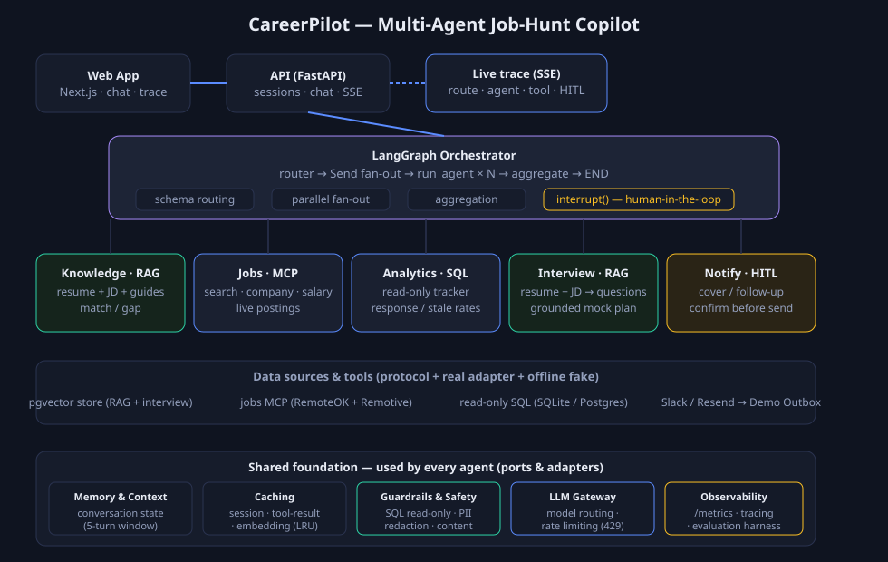

# CareerPilot — a multi-agent job-hunt copilot

**Live demo:** [careerpilot-raghu298.netlify.app](https://careerpilot-raghu298.netlify.app) ·
**API:** [careerpilot-seeh.onrender.com/health](https://careerpilot-seeh.onrender.com/health)
*(backend is on Render's free tier — the first request after idle takes ~30–60s to wake.)*

**Ask one question in plain English. A router sends it to the right specialist agent(s),
they run in parallel, and you get one combined answer — with every routing decision and
tool call streamed live.**

Built to demonstrate production-shaped multi-agent patterns — **LangGraph** orchestration,
schema-guarded routing, parallel fan-out, RAG, tool-calling **over MCP**, read-only SQL
guardrails, human-in-the-loop confirmation, and live SSE tracing — on a problem a job
seeker actually feels.

> Runs **fully offline with deterministic stand-ins** (no API key, no database). Set
> `OPENAI_API_KEY` to switch to real models; point env vars at a real Postgres / MCP
> server / Slack / Resend to light up the real adapters. Nothing changes in the agent code
> because everything depends on protocols, not vendor SDKs.

## The four agents

| Ask it… | Agent | How it works |
|---|---|---|
| *"Does my resume fit this JD? What are my gaps?"* | **Knowledge** | RAG over your resume + target job description + career guides (embeddings → pgvector → schema-guarded answer). Upload your own résumé/JD (PDF/TXT) via **"Use my resume"**. |
| *"Find GenAI roles at Nimbus Labs"* | **Jobs** | Multi-turn tool-calling over a **jobs MCP server** (`search_jobs`, `get_company`) against **live postings** (RemoteOK + Remotive); a role-plus-company question drives both tools in one loop. |
| *"How many applications got a response? Which are stale?"* | **Analytics** | Natural-language → **read-only** SQL over a **real SQLite** tracker of *your* applications (add them via **"My applications"**); 3 stacked guardrails. |
| *"Draft a follow-up email to the recruiter at Acme"* | **Notify** | Drafts tailored outreach and **stages it** — sends only after you confirm (human-in-the-loop) |

A single request can fan out to several agents at once, e.g.
*"Find a role I haven't applied to yet and draft a cover letter for it"* → **Jobs +
Analytics + Notify** concurrently, ending in a confirm-before-send card.

## Architecture



**Orchestration is a LangGraph `StateGraph`:**

```
START → router → (Send fan-out) → run_agent × N → aggregate → END
                                                        │
                                                   interrupt()  ← human-in-the-loop
```

- **Router** (`orchestrator/router.py`) — an LLM reasons about intent, but its decision is
  forced through a Pydantic `RoutingDecision` (`Literal["knowledge","jobs","analytics",
  "notify"]`). Invalid output is retried, never trusted.
- **Fan-out** — a conditional edge emits one `Send` per selected agent, so they run
  concurrently; a dict reducer merges each agent's result back into shared state.
- **HITL** — the `aggregate` node calls LangGraph `interrupt()` when a `ConfirmableAgent`
  stages an action; the caller resumes with Send/Edit/Cancel via `resume_pending`. A
  `MemorySaver` checkpointer persists the paused graph.

**Ports and adapters.** Domain code never imports a vendor SDK. `LLMClient`,
`EmbeddingClient`, `VectorStore`, `SQLClient`, and `JobsSource` are all protocols with one
real adapter each — which is why every agent is unit-tested with fakes (no network, no key).

**Guardrails.** Routing is schema-constrained; the Analytics Agent's SQL passes a regex
read-only filter (and a read-only DB role in production); the Notify Agent never lets the
LLM choose a destination and never sends without explicit confirmation.

## Tech stack

**Backend** — Python 3.11+, `asyncio`, **LangGraph**, FastAPI + SSE, OpenAI
(`gpt-4.1-mini` + `text-embedding-3-small`), Pydantic, PostgreSQL + `pgvector`, the official
`mcp` SDK, `httpx`.
**Frontend** — Next.js (static export), React, TypeScript, a streaming SSE client for the
live trace panel.
**Infra** — Netlify (frontend); the API deploys to any Python host (Render/Fly/Railway).

## Project structure

```
src/careerpilot/
  orchestrator/     # LangGraph graph, schema-guarded router, conversation memory
  agents/
    knowledge/      # RAG agent (resume / JD / career guides)
    jobs/           # tool-calling agent over the jobs MCP server
    analytics/      # NL → read-only SQL over the application tracker
    notify/         # HITL outreach drafter (ConfirmableAgent)
  core/             # Agent/LLM/Embedding protocols, tool-loop, tool cache, chunking
  integrations/     # adapters: pgvector, SQL (Postgres + real SQLite), jobs MCP (+fake), notifiers, offline brain
  access_policy.py  # persona → typed capability set (enforced before agents are built)
  bootstrap.py      # shared + per-session wiring reused by every entry point
api/                # FastAPI backend: sessions, chat (SSE), pending (HITL), docs, applications, outbox
mcp_server/         # real MCP server: live job search over RemoteOK + Remotive
web/                # Next.js frontend (chat, live trace, persona chooser, résumé + applications editors)
evaluation/         # golden-dataset eval harness: RAG regression + Recall@k/MRR, agent correctness, optional DeepEval
tests/unit/         # fake-backed tests — no network, no API key
```

## Getting started

```bash
# backend (offline — no key needed)
python -m venv .venv && source .venv/bin/activate
pip install -e ".[dev]"
pytest -q                            # 31 offline tests (no network, no key)
python -m evaluation.run_knowledge_eval   # RAG regression + Recall@k/MRR (offline)
python -m evaluation.run_agent_eval       # jobs relevance + NL→SQL + read-only guardrail
python scripts/chat.py               # CLI: try every agent from the terminal

# web app
uvicorn api.main:app --reload --port 8000
cd web && npm install && npm run dev   # http://localhost:3000
```

Pick **Riya Sharma** (active seeker) or **Arjun Mehta** (senior switcher, premium guides) —
no sign-up. Access differs by persona: premium salary-negotiation and leadership-resume docs
are visible only to Arjun, enforced in the retrieval query, not by prompt text.

### Going real (all optional)

| Capability | Set | Falls back to |
|---|---|---|
| Real models | `OPENAI_API_KEY` | deterministic offline brain |
| Application tracker | `DATABASE_URL` (+ read-only role) | **real in-memory SQLite** (you load your own applications) |
| Live job search | default: live RemoteOK + Remotive (no key); or `JOBS_MCP_URL`, `JOBS_MCP_TOKEN` | deterministic fake MCP |
| Real outreach | `SLACK_BOT_TOKEN` / `RESEND_API_KEY` … | Demo Outbox capture |

> **Note on "fakes":** the SQL tracker fallback is a *real* SQLite engine (genuine SQL execution + read-only guardrail), not a pattern-matching stub — and live job search runs against real postings by default. The offline brain only stands in for the LLM/embeddings when no `OPENAI_API_KEY` is set.

## Deploy

- **Frontend → Netlify** (`netlify.toml`): base `web`, build `npm run build`, publish `out`.
  Set `NEXT_PUBLIC_API_BASE` to your deployed API URL.
- **Backend → a Python host** (Render/Fly/Railway): `uvicorn api.main:app`. Netlify's
  serverless runtime is not suited to long-lived SSE + Postgres, so the API lives off-Netlify.

## Notes on provenance

CareerPilot is an independent project. It reuses well-known, non-copyrightable architecture
patterns (hexagonal design, schema-guarded routing, graph orchestration, HITL) and applies
them to the job-hunt domain with its own code.
